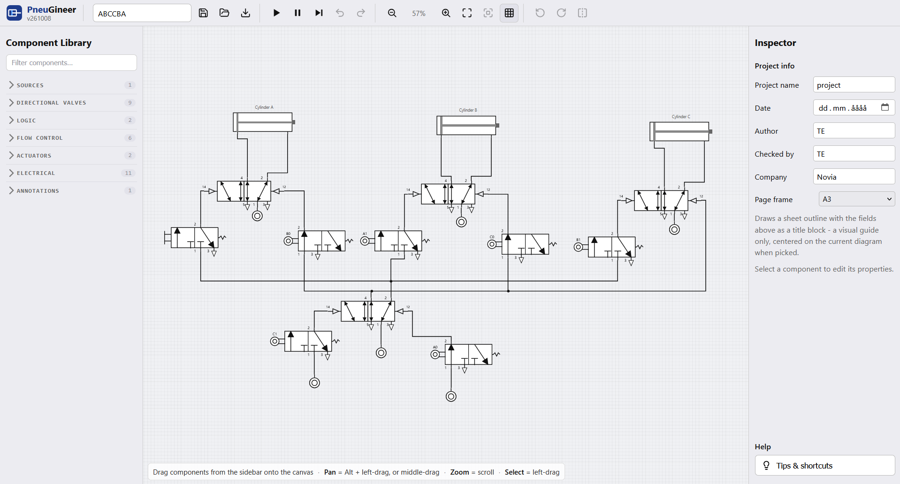

# PneuGineer

A browser-based pneumatic circuit editor and simulator. Drag components — valves, cylinders,
pressure sources, sensors — onto a canvas, wire their ports together, and run a play/pause/step
simulation with a live pressure overlay.

**▶ Try it in your browser: [bibbi88.github.io/PneuGineer](https://bibbi88.github.io/PneuGineer/)**

**⬇ Download the desktop app:**
[Windows installer](https://github.com/bibbi88/PneuGineer/releases/latest/download/PneuGineer-Setup.exe) ·
[Linux AppImage](https://github.com/bibbi88/PneuGineer/releases/latest/download/PneuGineer.AppImage) ·
[Linux Flatpak](https://github.com/bibbi88/PneuGineer/releases/latest/download/PneuGineer.flatpak) ·
[standalone HTML file](https://github.com/bibbi88/PneuGineer/releases/latest/download/PneuGineer.html) ·
[all releases](https://github.com/bibbi88/PneuGineer/releases)



This is an educational project focused on flow _logic_, not flow _calculations_ — pressure is
modeled as a simple pressurized/not-pressurized graph, not real fluid dynamics.

## Components

- Pressure source, 5/2 valve, AND / OR valve, check valve, throttle valve
- 3/2 limit valve, 3/2 push button, 3/2 air-piloted valve
- Double-acting and single-acting (push/pull) cylinders
- Time delay valve, quick-exhaust valve, one-way flow control valve

## Usage

- Drag a component from the sidebar onto the canvas.
- Click a port, then click another port to wire them together. Click a wire while linking to
  split it into a junction. Double-click a wire to drag its bend.
- Use Play / Pause / Step / Stop to run the simulation, and Undo / Redo to step through edits.
  While paused, Pause reads Play and resumes. A video recording pauses with the simulation.
- **Save** writes back to the circuit's file once it has one (Chrome, Edge, the desktop app);
  the ▾ beside it has Save as and Save all. **Open**'s ▾ lists the five most recent files and
  the examples.
- **Export** the circuit as PDF, SVG or PNG, with a zoom (fit to page, or 25-400 %). The ▾
  beside it has **Export several circuits**: tick which open circuits, one PDF with a page each,
  a PDF each, or PNG/SVG images, with a page preview and settings of its own per circuit.
- **Diagrams** (toolbar) plots what each run recorded - cylinder position, speed, chamber
  pressures, force and air used, the supply's air, flow meters, valves switching over, and every
  sensor, relay and solenoid - between any two events (e.g. from A0 turning off to it turning on
  again: one cycle, a displacement-step diagram). It lists start, end, min, max, average and
  integral (the air in Nl, energy in J), works out ratios, is saved with the circuit, and the
  whole run exports as CSV. The automatic-cycle example comes with one set up.
- Each cylinder's losses are typical seal friction, or an efficiency η (the rod gives
  F = p·A·η).
- The toolbar shows each button's name under its icon; **Settings → Toolbar** can show icons
  only. Work is autosaved locally and offered back if you return to an unsaved session.

Several circuits can be open at once, as **tabs** above the canvas (or listed in the inspector -
see **Settings**, the gear in the toolbar), each with its own undo history. **New circuit** in
the toolbar (or + on the tab bar) opens an empty one; the examples (under Open's ▾) and loaded files
open in a new tab. Every open circuit is kept in the browser and is back after a reload.

## Running PneuGineer

There are four ways to run the app, from simplest to most involved.

### 1. In the browser

Open [bibbi88.github.io/PneuGineer](https://bibbi88.github.io/PneuGineer/). Nothing to install.
The site is rebuilt and redeployed automatically on every push to `main`.

### 2. Offline, from a single file

The production build is one self-contained HTML file, [`dist/index.html`](dist/index.html), with
all scripts and styles inlined.
[Download it](https://github.com/bibbi88/PneuGineer/releases/latest/download/PneuGineer.html)
(`PneuGineer.html`, from the latest release) and double-click it to open it in your browser. It needs no server and no internet connection,
so it can be copied to a USB stick or shared by email.

### 3. As a desktop app (Windows, Linux)

The same app in its own window, without a browser - it opens and saves project files like any
desktop program, and greets you with recent files and the examples.

- **Windows:** download the
  [installer](https://github.com/bibbi88/PneuGineer/releases/latest/download/PneuGineer-Setup.exe)
  and run it. It isn't code-signed, so Windows SmartScreen may warn that it's from an unknown
  publisher: choose **More info → Run anyway**. Once installed it **updates itself**: at start
  it asks GitHub for a newer version, downloads it in the background and offers to restart into
  it (or installs it when the app is closed).
- **Linux, AppImage:** download the
  [AppImage](https://github.com/bibbi88/PneuGineer/releases/latest/download/PneuGineer.AppImage),
  make it executable (`chmod +x PneuGineer.AppImage`, or Properties → Allow executing) and run
  it - one file, nothing to install. Like the Windows app it **updates itself**. Ubuntu 24.04
  and later need the FUSE library once: `sudo apt install libfuse2t64`.
- **Linux, Flatpak:** download the
  [Flatpak](https://github.com/bibbi88/PneuGineer/releases/latest/download/PneuGineer.flatpak),
  then `flatpak install --user PneuGineer.flatpak` and start PneuGineer from the app menu (or
  `flatpak run io.github.bibbi88.PneuGineer`). The Freedesktop runtime it needs is fetched from
  Flathub on install.

**Internet use.** PneuGineer doesn't use the internet - the web app loads nothing from
anywhere once open, and your circuits never leave your device. The one exception is the update
check of the Windows app and the Linux AppImage, an ordinary download request to GitHub at
start. It can be turned off under **Settings → Updates**, after which the app never connects to
the internet. The Linux Flatpak doesn't update itself (use `flatpak update`, or install a newer
file) and never goes online.

Both are built by GitHub Actions ([`.github/workflows/desktop.yml`](.github/workflows/desktop.yml))
from [`desktop/`](desktop/) - an Electron shell around the built `dist/index.html` - on every push
to `main`, into the [latest release](https://github.com/bibbi88/PneuGineer/releases/latest). The
links above always fetch the newest. For a numbered release of its own (what Flathub packages),
push a version tag named after the day, in the same form as the builds' versions:

```bash
git tag v26.1201.0
git push origin v26.1201.0
```

The workflow can also be run by hand on any branch (**Actions → Desktop apps → Run workflow**);
such a run keeps the installer and the Flatpak as downloadable artifacts, without a release.

**Flathub.** [`flathub/`](flathub/) has everything needed to publish PneuGineer on Flathub - the
manifest, the store listing, the file type - and how to release and submit it
([`flathub/README.md`](flathub/README.md)). The **Flathub check** workflow builds and lints the
package exactly as Flathub would, on every push to `dev` that touches the desktop app.

### 4. From source

Requires [Node.js](https://nodejs.org/) 22 or newer.

```bash
npm install
npm run dev      # start the dev server, then open the URL it prints (http://localhost:5173)
npm run test     # run the unit test suite
npm run build    # type-check and write the single-file build to dist/index.html
npm run preview  # serve the built dist/index.html locally
npm run lint     # eslint + prettier check
```

## About the HTML files

- **`index.html`** (repo root) — the app's page skeleton and Vite's entry point: the toolbar,
  component sidebar, canvas layers and inspector panel, plus a `<script>` tag that loads
  `src/main.ts`. All behavior lives in the TypeScript under `src/`. This file can't be opened
  directly from disk, since browsers can't run the TypeScript it references — use
  `npm run dev`, or open the built `dist/index.html` instead.
- **`dist/index.html`** — the output of `npm run build`: `index.html` with the compiled
  JavaScript and CSS inlined into it (via `vite-plugin-singlefile`). This is the file that is
  deployed to GitHub Pages and that can be run offline.
